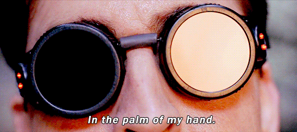

# Reflective Journal
by <striking>Felipe Amorim Castelo Branco</striking>

---

## *Journal 1 - Date: 2026-09-11*

Learning to code (even if just with markdown) has been both a huge headache and an extraordinary experience.

On one hand, ever since I typed github on the browser, I have been feeling **very** out of depth. I have had many small exposures to coding in my life from my father that was a programmer (then architect and nowadays IT manager focusing in Cybersecurity) and more recently, from my work as a LQA tester in the game industry, where I can sometimes spy the macros used such as ```</striking>```, ```</br>``` and the occasional ```{$number}``` and concatenated strings. 

That said, I have never even tried to learn *how* to code or why these macros appeared in the way they did. It's very daunting to face something seemingly so large and endless: A thousand coding languages, incountable details that are a 'must-know' for programmers. It's no wonder that people call it coding _languages_, rather than dialects or even "skills". Because this *is* a language, a very complex one that you have to completely change the way you think if you want to get anywhere at it. 

<sub>Luckily... I debug for a living ;P</sub>

Now, on the **other** hand, I can already taste the freedom on my fingers every time I type "</>" and push commits to github. As a Graphic Designer, I _loved_ UI/UX for the ability to do and animate anything I wanted, to really bring a project to life with Figma Prototypes. But I _hated_ it for the fact that all I could ever do was non-functional **prototypes**. 

Unlike printed media, where I knew exactly how to setup the document and export the pdf to print it myself and cut the pages of a magazine with my own hands and put everything together in a final product, UI/UX presented me a huge barrier between my visually pleasing projects and functional websites that I inevitably could only cross by handing off all my things to a stranger and hope they do it correctly.

Now, I have the **power of the sun...**

> 

<sub>...as long as I can learn to control it.</sub> 

Anyway, my deepest apologies for the prose. TL;DR: I'm very excited to learn coding. It's hard, but surprisingly fun. Even the debugging *("It's broken. Why is it broken? Ah, there it is.")* is a fun experience to me. I'm mostly at the "Monkey see, monkey do" trying out all the code I saw in the Hello World file, like the ```let``` functions, but I'll get there eventually. Of that, I have no doubt. 

---

## *Journal 2 - Date: 2026-09-18*

The "Instructions" challenge was something so familiar that I felt like I was paying back for all the times I said "Illustrator is so easy I could do it blindfolded". Well, now I'm doing illustrator while typing on a dark screen. 

The concept behind how to shape forms into pictures is the same in vectorial art and these coded compound paths. And even how the code is organized is so very similar to it:

```createCanvas()``` is pretty much the New Document window. Once you have an Artboard created, you start shaing things with squares and circles by making them as large or small as possible and dragging them around the canvas. Even the X, Y, and the size are just represented in a different format. 

But I was surprised to realize how instinctive it is. Even the layer organization works functionally the same, although inversed. The background goes at the <strikethrough>bottom</strikethrough> top and shapes will progressively layer themselves from the back to the front after that.

A square here, a triangle there and you have your cute little astronaut staring back at you. Surprisingly similar.
 
I also immediately adopted the ```function drawX ()``` to makeshift layer 'groups' and break down the image into specific areas. I'm not sure if that's something that can be done or if it's a big No-No in the computing community, but I gravitated towards that decision almost subconsciously. 
 
It was only in the second challenge that I discovered the ```push()/pop()``` commands. If using functions the way I have been doing is cringe or unrecommended, I'll adapt to using those. 

I also discovered Clipping Masks and filters such as Blur, but done old school style rather than accessing the Adobe Effects Library. It's a little weird to imagine that everything I've done in that app is just coding without the code. Every square created with a mouse was a ```square(x,y,size)``` being noted down in the background. 

It was a challenge to figure out the exact pixel to anchor my forms, but it's like playing chess in your own head. Seems impossible at first, but if you actually understand what's going on, it's just a matter of keeping track of everything. 

Now I can't help but imagine actual frame-by-frame animations are just a step away from what I'm doing here. It's all code, after all, right?

---

## *Journal 3 - Date: 2026-09-27*

The doors have been OPENED!

That's how I felt upon realizing I just made my first videogame. All the endless possibilities I spoke of, so quickly becoming reality. 

Honestly, it wasn't even my objective at first. I started simple, with a prototype just playing around mouseX. Then another one playing with mouseX and mouseY, where I decided it would be fun to have a button to "Save" the image. And well, once you know how to do a button, you know how to make many buttons. 

It's interesting to note that coding is so intuitive for me that the true challenge lies mostly in linguistics. It's easy to know exactly what you want the code to do, it's not even hard to break it down step by step as a computer would do. (Draw, if I press W, go forward 5% of the canvas. Once I reach the bottom right, display a "you win" screen... etc etc). The single most difficult part is figuring out exactly *how* these steps are announced in coding language. What function, what variables to use, the order in which they should appear, if it's a ```=``` or ```:```, all the little details that can and WILL break your code. 

To be fair, it helps having a veteran of coding on my fingertips. I'm usually always asking how to use "this" function or why "that" isn't happening as I expected on the screen to my dad, who worked as a software programmer for a long long time. It's even more helpful that he has a tendency to ramble and explain the "WHY" of every single thing that is on the screen. Ask about a ```let``` function and soon he's explaining ```console.log``` and showing how the computer reads the functions and why the order matters.

Still, [Gameboy Unadvanced](https://artcbranco.github.io/cart253/pr/challenges/variables/gameboy-unadvanced/) and [Polka Dot Abstract](https://artcbranco.github.io/cart253/pr/challenges/variables/polkadot/) are officially my first fully interactive videogames, gameboy even more so. And they were so simple that as I wrote, I was already thinking of improvements. "If I can make the square move, can I make a draw once it reaches x? If I restricted it's movement to the green area, can I restrict it in certain spots to create walls? Can I make Snake?" and I'm very curious to see where these thoughts will take me. 

---

## *Journal 4 - Date: 2026-10-06*

This week, I ran head first into a wall. Then I headbutted it again, hoping to open a path. Meanwhile, there was a door right beside it. 

It frustrated me, I spent a long time looking up things in advance only to miss what was directly in front of me. And the unused code (trasformed in comments to disable them) piled up and up at the bottom of the document until I didn't recognize what was going on in my own code. It wasn't as good of a week as the other ones... BUT I got it working in the end! Not in the way I wanted it and not as complex as I wanted it, but it works! I think the hardest part of these projects every week is knowing how to judge whether an idea is easy, doable or impossible to be done within the time limit. I get very easily carried away by thinking literally "anything" is possible, which is something I should probably work on. Not to say "do the bare minimum" but to learn how to look at a plan and say "yeah, I think I need to scale back some features on this to make it fearsible."

Anyway. Projects are almost done, and I'm ready to start next week's prototypes. 


---

## *Journal 5 - Date: 2026-10-18*

It`s fun to realize how easy the logic behind some of the games works. Flappy bird, for example, the project I chose to recreate for this week's prototype, is nothing more than a square that continuously gets -1 to it`s ```y-axis``` and gets +10 when the player jumps. Even more complex games slowly start to make more sense. I was playing bokura, a 2D platform coop game, earlier today and I realized that platforming is just a moving square displaying an image. Multiple images, actually, depending on the condition. MOve forward? ```movefoward.png```, drag a box around? ```boxdragged.png```, etc. And all the conditions, like the platforms and the abysses that get you killed, are just lines of codes saying "If Y falls from a large height, ```gameOver()```, or if ```y > half the canvas && player x = platform x```,  the player successfully stands on the platform. Thoughts like those are slowly seeping into my subconscious now whenever I play videogames. I *knew* that since I first started playing videogames: Games are made of code. Code works on logic. But one thing is to know about it, understanding what it means and more importantly, the logic behind all that, is another thing entirely. It`s really awesome, and I really gained a new appreciation for all the work that was put into anything made of coding. 

As for this weeks prototypes, I don't have much to say. I had a lot of very frustrating moments when the code didn't work, and a lot of very high emotions when the error was found and the code *did* work. I'm proud of my piano, even if it doesn't fully work the way I expected it to (The sound gets stuck when keys are pressed too fast), and I like the fact that I managed to kinda recreate a famously annoying game. I'm hyped for next week.

---

## *Journal 6 - Date: 2026-10-27*

Getting the chance to go back and improve on a project I worked previously was a very interesting experience. First, I could see just how much I improved and how much more broad my coding vocabulary was compared to just a few short weeks ago. Second, it was a chance to keep going and redesign an unfinished project, which I wanted to do it ever since I stopped working on it. It gave me the idea to take this same project for the next few prototypes and slowly add more and more features to it, until by the end of the session I have a full game. This week, with the array's prototype, I'll add walls to it. Next week, a point system, etc, until it's a complete game from start to finish. If, of course, I'm allowed to do so. I saw on instagram a game designer that worked on several major projects such as OW and WOW comment that one of the biggest problems of learning game design is to try and make a great game. People often try that, and end up frustrated. They should instead just make a game, any game, just to understand the basics, then make it great afterwards. I think that's what I'll end up doing with Gameboy. 

The other project, Hangman, was also interesting. I didn't realize how simple children's games are until I had to translate it into code. Hangman, TicTacToe, rock paper scissors... Now that I know the basics of P5JS, I feel like writing those wouldn't take much at all. A few variables, a draw function and I'd have a functional prototype. It's an interesting thing to think about. 