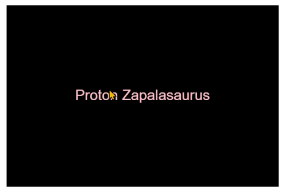

# Terrible Car Name

Code by Pippin Barr. Challenge by Felipe Amorim Castelo Branco, Konstantinos Christodoulakis and Felipe S. Paiva

[View this project online](https://github.com/artCBranco/cart253/tree/main/pr/w9/dinocar)

## Description

A program to generate new car model names using dinosaurs.
 * 
 * 

## Screenshot(s)

> 

## Attribution

This project uses [p5.js](https://p5js.org).
Uses [Darius Kazemi's corpora repository](https://github.com/dariusk/corpora/tree/master)

## License

This  is a non-monetized schoolwork and, as such, is protected by the Fair Dealing exception under the Copyright Laws for Educational Projects([Fair Dealing Classroom](https://www.cmec.ca/docs/copyright/CopyrightFairDealingClassroom_EN.pdf)).